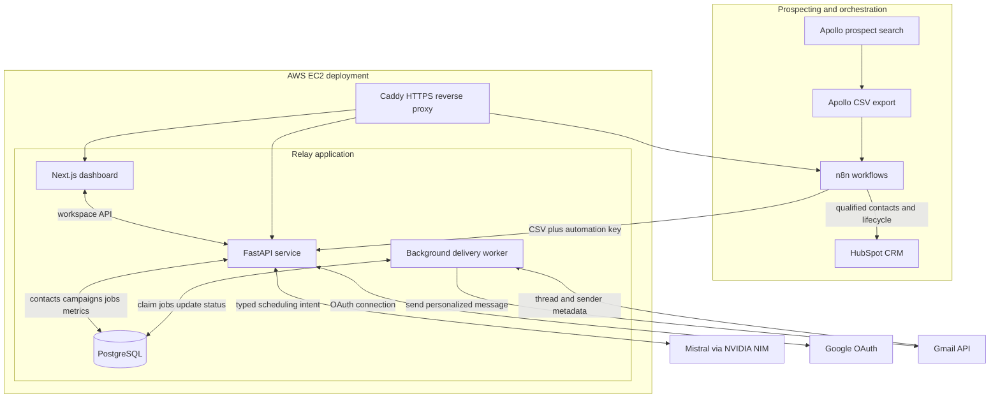
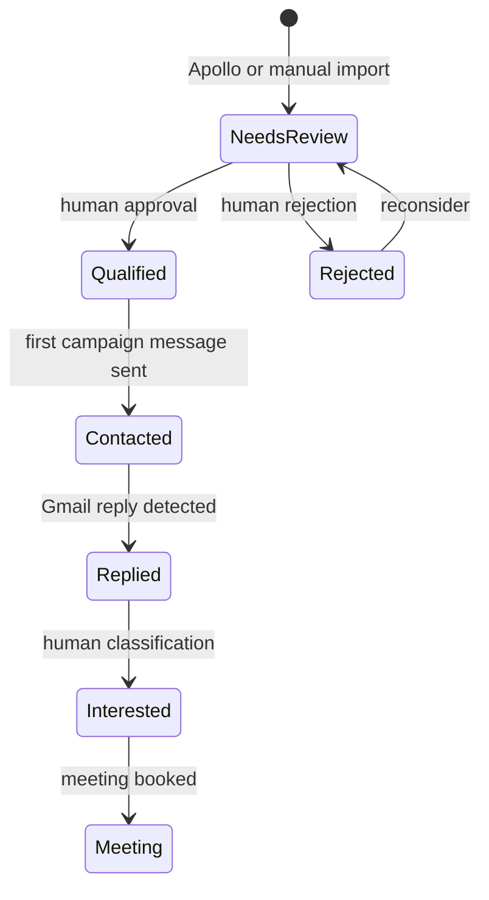

# Relay AI architecture

Relay is a workspace-scoped GTM automation system. The API is the source of truth for contacts, approval state, campaigns, and delivery jobs; n8n connects external prospecting and CRM systems without bypassing Relay's validation rules.

## System diagram

## Lead and campaign lifecycle

Only qualified contacts can enter a campaign. A contact can have one active sequence at a time. When Relay detects a reply, it marks the recipient as replied and cancels that recipient's remaining pending steps without affecting other recipients.

## Service responsibilities

| Component | Responsibility |
| --- | --- |
| Next.js | Workspace switcher, review queue, campaign composer, delivery activity, and funnel dashboard |
| FastAPI | Authentication, tenant isolation, validation, scoring, campaign expansion, and metrics |
| PostgreSQL | Durable contacts, OAuth credentials, campaigns, recipients, and scheduled delivery jobs |
| Worker | Row-locked job claiming, Gmail delivery, retries, reply polling, and stop-on-reply |
| n8n | Apollo CSV ingestion and HubSpot handoff |
| Mistral via NVIDIA NIM | Converts natural-language scheduling requests into a proposed typed intent |
| Caddy | HTTPS termination and routing for Relay and n8n |

## Security and reliability boundaries

- Every contact, campaign, and metric query is scoped to the active workspace.
- n8n imports use a dedicated automation key and an allowlisted workspace ID.
- OAuth tokens are encrypted at rest; Gmail credentials are never sent to the model.
- Imported CSV files pass through the same validation, size limits, deduplication, and scoring code as manual imports.
- The model proposes an intent only. Application code validates it, and a user confirms before jobs are created.
- Delivery jobs are durable and use row locking, bounded retries, and stale-lock recovery.
- PostgreSQL and Caddy certificate data live in persistent Docker volumes.

## Deployment topology

The portfolio deployment runs Caddy, Next.js, FastAPI, the worker, PostgreSQL, and n8n as Docker Compose services on one EC2 instance. This keeps the demo inexpensive and reproducible. A production-scale evolution would move PostgreSQL to RDS, application containers to ECS, and secrets to AWS Secrets Manager.
